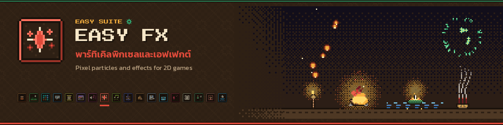
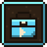
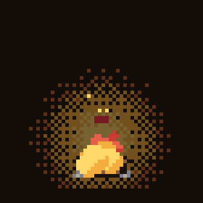
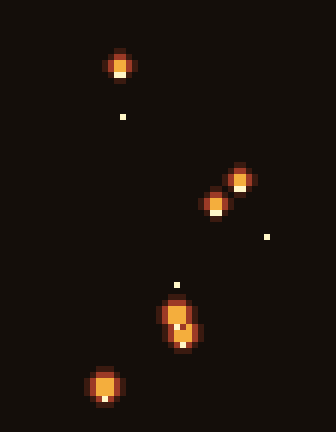
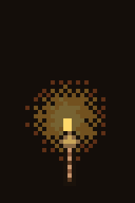
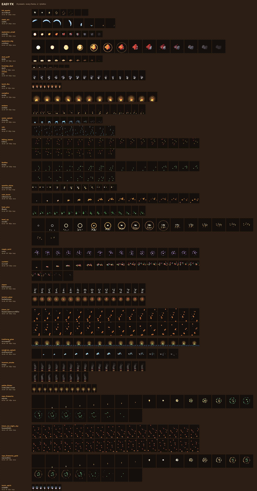
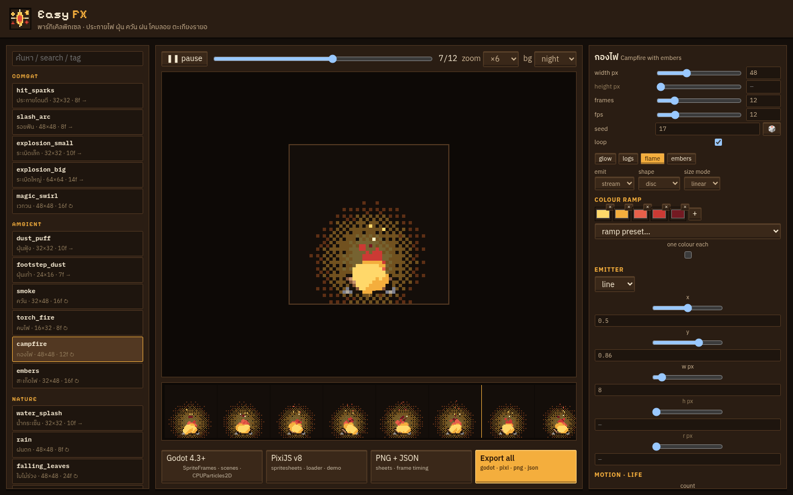

<!-- easy-suite:header:start -->
<p align="center">
  <a href="#easy-suite"></a>
</p>

<p align="center">
  <b>Easy FX</b> · พาร์ทิเคิลพิกเซลและเอฟเฟกต์ · Pixel particles and effects for 2D games<br />
  <sub>Part of <a href="#easy-suite"><b>Easy Suite</b></a>: Thai-friendly pixel-art game dev tools for Godot 4.3+ and PixiJS v8</sub>
</p>

<p align="center">
  <a href="https://github.com/Saladin2020/easyfx/actions/workflows/ci.yml"></a> <a href="LICENSE"></a>  <a href="#export"></a> <a href="docs/MCP.md"></a> 
</p>

<p align="center">
  <a href="https://github.com/Saladin2020/easysprite"></a>
  <a href="https://github.com/Saladin2020/easyscene"></a>
  <a href="https://github.com/Saladin2020/easytilemap"></a>
  <a href="https://github.com/Saladin2020/easydialogue"></a>
  <a href="https://github.com/Saladin2020/easyquest"></a>
  <a href="https://github.com/Saladin2020/easyui"></a>
  <a href="https://github.com/Saladin2020/easysfx"></a>
  <a href="https://github.com/Saladin2020/easyfx"></a>
  <a href="https://github.com/Saladin2020/easymusic"></a>
  <a href="https://github.com/Saladin2020/easyanim"></a>
  <a href="https://github.com/Saladin2020/easyitems"></a>
  <a href="https://github.com/Saladin2020/easysave"></a>
  <a href="https://github.com/Saladin2020/easykit"></a>
</p>
<!-- easy-suite:header:end -->

# Easy FX

**พาร์ทิเคิลพิกเซลสำหรับเกม 2D · ประกายไฟ ฝุ่น ควัน ฝน โคมลอย กระทง สงกรานต์ ตะเกียงปลิตา พลุรายอ**  
Describe an effect as a few particle layers in a small JSON format (count, lifetime, speed, gravity, spread,
colour ramp, frames, size, seed), preview it live in a web editor, and export a **PNG spritesheet + frame
timing JSON**, a **Godot 4.3+** project (SpriteFrames `.tres`, ready `AnimatedSprite2D` scenes and
`CPUParticles2D` presets) or a **PixiJS v8** spritesheet with a tiny loader. 28 built-in presets sized for the
suite's 48px characters. A sibling of [Easy Sprite](https://github.com/Saladin2020/easysprite),
[Easy Scene](https://github.com/Saladin2020/easyscene), [Easy SFX](https://github.com/Saladin2020/easysfx)
and [Easy UI](https://github.com/Saladin2020/easyui).

[](https://nodejs.org)

> Easy FX **simulates · draws · exports**. Every pixel comes from a seeded simulation (CC0): no image
> generation, no textures, no paid APIs. The same seed gives the same frames in the CLI, the web editor, the
> Godot sheets and the Pixi sheets. Looping effects wrap seamlessly (no warm-up frame, no pop at the seam).

<p align="center">
  
  
  
  
</p>

---

## What you get

| Presets (28) | Layers | Export |
| --- | --- | --- |
| **combat** hit_sparks, slash_arc, explosion_small, explosion_big, magic_swirl · **ambient** dust_puff, footstep_dust, smoke, torch_fire, campfire, embers · **nature** water_splash, rain, falling_leaves, fireflies · **reward** sparkle_shine, coin_burst, heal_plus, level_up · **food** steam · **festival** confetti, lantern_glow, khom_loi, krathong_glow, songkran_splash, incense_smoke, pelita_flicker, raya_fireworks | `particles` (burst or seamless stream; 14 pixel shapes, 5 emitters, gravity, wind, drag, swirl, wobble, flicker, spin, floor, dither fades, 1px outline), `glow` (dithered halo with pulse/flicker), `arc` (slash sweep), `prop` (torch, logs, krathong, pelita, incense holder, lantern, ripples, stall pot) | Godot 4.3+ project (SpriteFrames `.tres`, `AnimatedSprite2D` scenes, `CPUParticles2D` presets, `EasyFx.spawn()`), PixiJS v8 spritesheets + `easyfx-pixi.js` + demo, PNG sheets + frame JSON, resolved JSON |

<p align="center">
  
</p>

**Festivals of the village · เทศกาลในหมู่บ้าน**: the festival set follows the suite's multicultural southern Thai
town. **Loy Krathong / Yi Peng** sky lanterns (โคมลอย) and a krathong candle on the river, a **Songkran** water
splash, **incense smoke** for the temple or the Chinese-Thai shrine, and for **Hari Raya** (รายอ) the flickering
pelita oil lamps and night fireworks. All effects are generic objects and light: no people, no sacred figures and
no script or calligraphy.

## Quick start

```bash
npm install
npm run build
npx easyfx init                  # effects/ exports/ + 3 sample workspace effects
npx easyfx list                  # 28 presets + workspace effects
npx easyfx render campfire --scale 4 --out campfire.png
npx easyfx serve --open          # web editor → http://127.0.0.1:8848
npx easyfx export                # exports/easyfx-{godot,pixi,png,json}
```

`EASYFX_HOME` (or `EASYFX_WORKSPACE`, or `--workspace`) picks the workspace; otherwise the current folder.

<p align="center">
  
</p>

The editor plays the effect live (pause, scrub, zoom, night / teak / grass / sky / dusk / checker backdrops, anchor cross),
shows the frame strip, and lets you edit every param per layer with sliders, a colour-ramp editor and a seed dice.
Save writes `effects/<id>.easyfx.json`; the export buttons run the same exporters as the CLI.

## CLI

| Command | What it does |
| --- | --- |
| `init` | create `effects/` and `exports/` with three sample effects |
| `info` · `list [--tag t] [--json]` | workspace summary · presets and workspace effects |
| `show <id>` | resolved params as JSON |
| `check <id or file>` | validate (JSON path + message); exit code 1 on errors |
| `render <id> [--out p] [--scale n] [--cols n] [--frame n] [--seed n] [--set k=v …]` | PNG strip or a single frame |
| `new <id> --from <preset> [--set k=v …] [--th] [--en] [--force]` | write `effects/<id>.easyfx.json` |
| `export [ids…] [--preset godot\|pixi\|png\|json\|all] [--tag t] [--out dir] [--scale n]` | exports |
| `serve [--port 8848] [--dev] [--open]` | web editor + API |

`--set` paths: `count=20` (first particle layer), `seed=7`, `1.ramp=#fff6c8,#f4ae3d` (layer 1),
`0.emitter.x=0.4`, `*.gravity=0` (every layer that has it), `frames=24` (top level).

## Effect format

```json
{
  "format": "easyfx/1",
  "th": "คบไฟสีฟ้า", "en": "Blue spirit torch",
  "base": "torch_fire",
  "set": {
    "seed": 1301,
    "2.ramp": ["#ffffff", "#c8f0ff", "#7cc8e8", "#4f8ac8", "#2c6aa8"]
  }
}
```

Start from a preset (`base` + `set` overrides) or write full `params`
(`size`, `height`, `frames`, `fps`, `loop`, `seed`, `anchor`, `layers[]`). Full reference: [docs/FORMAT.md](docs/FORMAT.md).

## Export

| Preset | Output (`exports/easyfx-<preset>/`) |
| --- | --- |
| `png` | `sheets/<id>.png` + `sheets/<id>.json` (frame rects, duration per frame, anchor) and `easyfx.json` manifest |
| `pixi` | PixiJS v8 Spritesheet JSON per effect (`animations`, per-frame anchor), `easyfx-pixi.js` (`loadFx(PIXI, url)` → `create(id)`, `play`, `ids`, `info`; one-shots remove themselves) and `index.html` demo (uses `./pixi.min.js` if present, else jsDelivr) |
| `godot` | Godot 4.3+ project: `easyfx/frames/<id>.tres` SpriteFrames, `easyfx/scenes/<id>.tscn` (`AnimatedSprite2D` + `easyfx_effect.gd`: `free_when_done`, `replay()`), `easyfx/particles/<id>.tscn` `CPUParticles2D` presets, `easyfx.gd` (`EasyFx.spawn(parent, "coin_burst", pos)`), `main.tscn` and `particles.tscn` demos, `test_fx.gd` |
| `json` | resolved params per effect |

The **sheets are the exact pixels**. The `CPUParticles2D` presets are a live approximation for when you want real
particles in the engine: same count, lifetime, speed, gravity, spread, colour ramp (stepped gradient) and scale curve,
but no wobble, outline, glow, arc or prop layers. Convert one to `GPUParticles2D` in the Godot editor if you need it.

```gdscript
# Godot: one-shot hit sparks where the sword lands
EasyFx.spawn(self, "hit_sparks", hit_position)
```

```js
// PixiJS v8
const fx = await loadFx(PIXI, "easyfx.json");
const coins = fx.create("coin_burst"); coins.position.set(120, 80); app.stage.addChild(coins); coins.play();
```

### Weather overlays

`rain`, `storm_rain`, `fog_drift` and `wind_gust` tile seamlessly. `weather()` lays one over the screen with a tint,
keyed by the [Easy NPC](../easynpc) calendar weather (`clear cloudy rain storm wind fog`):

```js
const w = fx.weather(app.stage, npcs.weather(), { width: 640, height: 360, scale: 2 });
npcs.on("weather", (k) => w.set(k));
```

```gdscript
NPCs.weather_changed.connect(func(k): EasyFx.weather($Overlay, k, get_viewport_rect().size, 2.0))
```

## MCP

`npm run mcp` (stdio) or `npm run mcp:http` (→ `http://127.0.0.1:8849/mcp`). Tools: `workspace_info`, `list_effects`,
`get_effect`, `write_effect`, `render_effect` (returns the strip as an image), `export_fx`. See [docs/MCP.md](docs/MCP.md).

## Security

Local-first: the API and MCP HTTP server bind to `127.0.0.1`; any other interface needs the bearer token printed at
startup (or `EASYFX_TOKEN`), and browser requests must come from the editor's own origin. File paths stay inside the
workspace (plus `EASYFX_ALLOWED_DIRS`). Effect ids are `[a-z0-9_-]`. Nothing calls a network or paid API.

## Development

```bash
npm run typecheck && npm test && npm run build && npm run smoke
GODOT=/path/to/godot npx vitest run test/godot.test.ts     # headless Godot import + test_fx.gd
python3 scripts/check-pixi.py exports/easyfx-pixi          # Pixi demo in headless Chrome
npm run dev                                                # API :8848 + Vite :5180
npm run icons                                              # favicon / PWA icons
npm run docs:images                                        # contact sheet + GIFs in docs/assets
```

Golden hashes of every preset live in `test/golden.json` (`UPDATE_GOLDEN=1 npx vitest run test/sim.test.ts` after a
deliberate preset change).

<!-- easy-suite:table:start -->
## Easy Suite


Thirteen small, local-first tools that share one look (teak, lantern gold, Kanit, 16/48px pixels), one
workflow (CLI · web editor · MCP server) and the same targets (**Godot 4.3+** and **PixiJS v8**).
ชุดเครื่องมือทำเกมพิกเซลสไตล์ไทย ใช้ร่วมกันได้ทั้งชุด · **Easy Kit** builds a whole playable game from the other twelve.  
The samples share one multicultural southern Thai village: Buddhist temple, wooden kampung mosque and
Chinese-Thai shrine on the same street. หมู่บ้านพหุวัฒนธรรม วัด มัสยิด ศาลเจ้า อยู่ร่วมกันในเมืองเดียว

| | Tool | What it does | Repo |
|:-:|---|---|---|
|  | [**Easy Sprite**](https://github.com/Saladin2020/easysprite) | Compose modular 48px chibi characters (top-down + side-view) and export sheets. | [`easysprite`](https://github.com/Saladin2020/easysprite) |
|  | [**Easy Scene**](https://github.com/Saladin2020/easyscene) | Side-view levels: parallax layers, 16px autotiles, Thai town props. | [`easyscene`](https://github.com/Saladin2020/easyscene) |
|  | [**Easy Tilemap**](https://github.com/Saladin2020/easytilemap) | Top-down 16px maps: blob-47 autotiles, objects, collision, spawns. | [`easytilemap`](https://github.com/Saladin2020/easytilemap) |
|  | [**Easy Dialogue**](https://github.com/Saladin2020/easydialogue) | Branching `.ezd` dialogue with Thai-safe text, portraits and choices. | [`easydialogue`](https://github.com/Saladin2020/easydialogue) |
|  | [**Easy Quest**](https://github.com/Saladin2020/easyquest) | Text `.ezq` quests: steps, flags, items, rewards, linked to dialogue. | [`easyquest`](https://github.com/Saladin2020/easyquest) |
|  | [**Easy UI**](https://github.com/Saladin2020/easyui) | Nine-slice pixel UI kit: panels, bars, inventory, menus, 30 icons. | [`easyui`](https://github.com/Saladin2020/easyui) |
|  | [**Easy SFX**](https://github.com/Saladin2020/easysfx) | Deterministic 8-bit SFX and 4-channel chiptune loops, typing blips. | [`easysfx`](https://github.com/Saladin2020/easysfx) |
|  | **Easy FX** ← you are here | Pixel particles: sparks, fire, rain, lanterns, Raya pelita; sheets + Godot particles. | [`easyfx`](https://github.com/Saladin2020/easyfx) |
|  | [**Easy Music**](https://github.com/Saladin2020/easymusic) | Seeded Thai loop music: ranat, khong wong, saw, khim, pi, kompang; seamless WAV/OGG loops. | [`easymusic`](https://github.com/Saladin2020/easymusic) |
|  | [**Easy Anim**](https://github.com/Saladin2020/easyanim) | Cutscene timelines: actors, camera, dialogue, FX and music cues; Godot + Pixi runners. | [`easyanim`](https://github.com/Saladin2020/easyanim) |
|  | [**Easy Items**](https://github.com/Saladin2020/easyitems) | Item database, shops, inventory, loot tables and crafting; 44 starter items with pixel icons. | [`easyitems`](https://github.com/Saladin2020/easyitems) |
|  | [**Easy Save**](https://github.com/Saladin2020/easysave) | Versioned save slots with migrations and checksums; Thai / English / Malay string tables. | [`easysave`](https://github.com/Saladin2020/easysave) |
|  | [**Easy Kit**](https://github.com/Saladin2020/easykit) | One command drives all 12 tools into a playable Godot 4.3+ and PixiJS game; unified MCP server and `doctor`. | [`easykit`](https://github.com/Saladin2020/easykit) |

### Works with

- Sized for **Easy Sprite**'s 48px characters: hit sparks, slashes, footstep dust and level-ups line up with their feet and hands.
- Torches, lanterns, steam and pelita sit on **Easy Scene** / **Easy Tilemap** props; coin bursts and heals pair with **Easy Quest** rewards and **Easy UI** HUDs.
- Pair each effect with an **Easy SFX** sound (hit, coin, firework); Godot SpriteFrames and a PixiJS v8 spritesheet, like its siblings.
<!-- easy-suite:table:end -->

## Credits

All effects, shapes and props are generated from code and CC0. Kanit © The Kanit Project Authors (SIL OFL 1.1),
used only in the docs art. See [CREDITS.md](CREDITS.md). Code: MIT © Salahuddin Benno.
